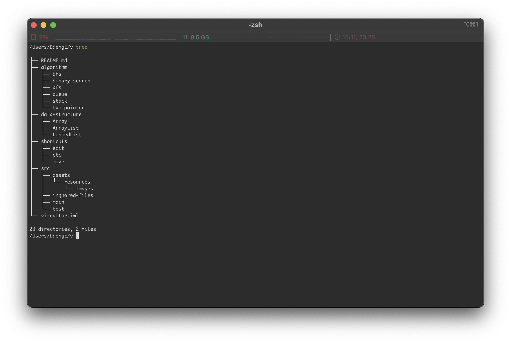

# 🧑🏽‍💻VIM(vi improved)

### ⭐️개요
- [vim은 vi와 호환되는 문서 편집기로 1991년 네덜란드의 브람 몰레나르(Bram Moolenaar, 1961–2023)가 만들었다.](https://namu.wiki/w/vim "출처:나무위키")

### ✏️작성 취지
- terminal 환경에서 vi editor 를 친숙하게 사용하기 위한 목적
- 리눅스마스터1급 2차 대비

### 🗂️구조 (초기 구상)

- 위 그림은 `algorithm`(bfs·dfs·binary-search 등), `data-structure`(Array·ArrayList·LinkedList), `shortcuts`(edit·move·etc)로 나눠 정리하려던 **폴더 골격**이다.
- 당시 파일은 README와 IDE 설정뿐이고 나머지는 전부 빈 폴더였다(그림 하단 `23 directories, 2 files`). git은 빈 폴더를 저장하지 않아 저장소에는 올라가지 않았다.
- 알고리즘 풀이는 [baekjoon-algorithm-slove](https://github.com/yeeooni/baekjoon-algorithm-slove), Java 학습 코드는 [exercise_book](https://github.com/yeeooni/exercise_book)에 있다.
- 이 저장소는 현재 **vim 환경설정 메모**만 담고 있다.

### ✅체크리스트
- [X] 디렉터리 정리
- [ ] CI/CD 구축
- [X] 필수 환경설정 세팅
  - [X] vim-plug install (_[vim-plug](https://github.com/junegunn/vim-plug)_, vi 노말모드에서 명령어를 통한 손쉬운 플러그인 설치가 가능하다.) 
  - [X] NERDTree plug install
  - [X] coc.nvim install (_[coc.nvim](https://github.com/neoclide/coc.nvim)_, 노드 기반 코드 자동완성) 
  - [X] coc-java install (_[coc-java](https://github.com/neoclide/coc-java)_)

### 📎부록: git submodule 명령 메모
- `git submodule add <repository_url> <path>` : 추가 (`.gitmodules`에 path와 url이 함께 기록됨)
- `git submodule init`
- `git submodule update`
- `git submodule update --init`
- `git submodule status`
- `git submodule update --remote <submodule name>`

서브모듈 삭제 방법
- `git submodule deinit -f <path>` 후 `git rm -f <path>` (git latest version)

> 이 저장소에 있던 `exercise_book` 서브모듈은 `.gitmodules`에 `path`가 빠져 있어 `git submodule update`가 실패했고(`no submodule mapping found`), 현재는 제거했다.
